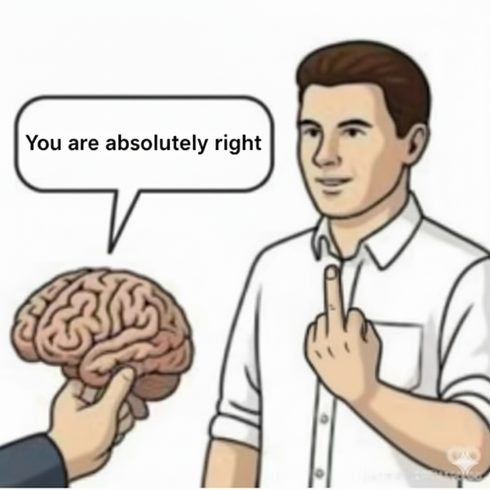

# 🧠 AbsolutelyRight / 绝对正确

<div align="center">

### The Ultimate Collection of AI Agent Memes
### AI Agent 梗图终极收藏馆

*When your AI agent finally understands your prompt on the 10th try*
*当你的 AI agent 终于在第10次理解了你的提示词*



</div>

---

## 🎭 What is this? / 这是什么？

**English:** Welcome to the sacred hall of AI Agent memes, where we collect the most relatable, hilarious, and painfully accurate memes about working with AI agents. Because sometimes, the only way to cope with prompt engineering is through memes.

**中文：** 欢迎来到 AI Agent 梗图圣殿，这里收集了关于使用 AI Agent 最真实、最搞笑、最痛并快乐着的梗图。因为有时候，用梗图是应对提示词工程的唯一方式。

## 🎯 Our Mission / 我们的使命

```
if (your_AI_experience == "absolutely_right") {
    contribute_meme();
} else {
    contribute_meme_anyway();  // 因为挫折也是好梗图
}
```

## 🔥 Featured Memes / 精选梗图

### When someone asks "Are you still coding manually?" / 当有人问"你还在手写代码吗？"


> "不用了，我正在用AI写代码" - Every developer in 2025

## 📚 Categories / 分类

- 🤖 **Prompt Engineering Fails** / 提示词工程翻车现场
- 🎯 **When AI Gets It Right** / AI 开窍的瞬间
- 😭 **Debugging with AI** / 和 AI 一起调试的血泪史
- 🚀 **AI Agent Superpowers** / AI Agent 的超能力时刻
- 💔 **Token Limit Heartbreaks** / Token 限制心碎时刻
- 🔄 **Context Window Gymnastics** / 上下文窗口体操
- 🎪 **Hallucination Hall of Fame** / 幻觉名人堂

## 🎮 How to Contribute / 如何贡献

### The Easy Way / 简单方式
1. **Fork** this repo / 先 Fork 这个仓库
2. **Add** your meme to `memes/` folder / 把梗图加到 `memes/` 文件夹
3. **Submit** a PR with a funny description / 提交 PR，记得写个好笑的描述
4. **Wait** for the community to say "You are absolutely right!" / 等待社区说"你说得对！"

### The Meme Way / 梗图方式
```bash
git clone https://github.com/Deepractice/AbsolutelyRight
cd AbsolutelyRight
mkdir -p memes/your-meme
cp your-meme.png memes/your-meme/
git add .
git commit -m "My AI agent made me do this"
git push
# Open PR titled: "This meme debugged my life"
```

## 🏆 Hall of Fame / 名人堂

- 🥇 **Most Relatable Meme** / 最有共鸣梗图
- 🥈 **Best Prompt Fail** / 最佳提示词翻车
- 🥉 **Funniest Hallucination** / 最搞笑幻觉

## 🎪 Community Rules / 社区规则

1. **No meme is too niche** - If you get it, someone else will too
   **没有梗太小众** - 你懂的，总有人也懂

2. **Respect the context window** - Keep descriptions concise
   **尊重上下文窗口** - 描述要精炼

3. **Hallucinations welcome** - Sometimes AI's mistakes are the best memes
   **欢迎幻觉** - 有时候 AI 的错误就是最好的梗

4. **Credit your AI** - If your agent helped create the meme, give credit
   **致谢你的 AI** - 如果你的 agent 帮你创作了梗图，记得致谢

## 🚀 Sponsored by / 赞助商

<div align="center">

### Built with love by humans and AI agents at
### 由人类和 AI agents 在此用爱打造

**[Deepractice.ai](https://deepractice.ai)** - Making AI Accessible / 让 AI 触手可及
*Where we turn "absolutely wrong" into "absolutely right" with PromptX*
*在这里我们用 PromptX 把"完全错误"变成"绝对正确"*

</div>

## 📢 Join the Movement / 加入运动

- ⭐ **Star** this repo if AI agents have ever made you laugh-cry / 如果 AI 让你笑中带泪，请点个星
- 🔄 **Share** your worst prompt engineering moments / 分享你最惨的提示词工程时刻
- 💬 **Discuss** in Issues - "Is this a bug or a feature?" / 在 Issues 讨论 - "这是 bug 还是 feature？"
- 🎨 **Create** memes about your AI adventures / 创作你的 AI 冒险梗图

---

<div align="center">

### Remember / 记住

*In the world of AI agents, you are always absolutely right...*
*...until the next model update*

*在 AI agent 的世界里，你永远是绝对正确的...*
*...直到下次模型更新*

**#AbsolutelyRight #AIAgentMemes #PromptEngineeringLife**

</div>

---

<sub>This README was co-created by a human and an AI agent. The human is absolutely right about the memes. The AI agent is absolutely right about everything else. Both are absolutely wrong about token limits.</sub>

<sub>这个 README 由人类和 AI agent 共同创作。人类对梗图绝对正确。AI agent 对其他所有事情绝对正确。两者对 token 限制都绝对错误。</sub>